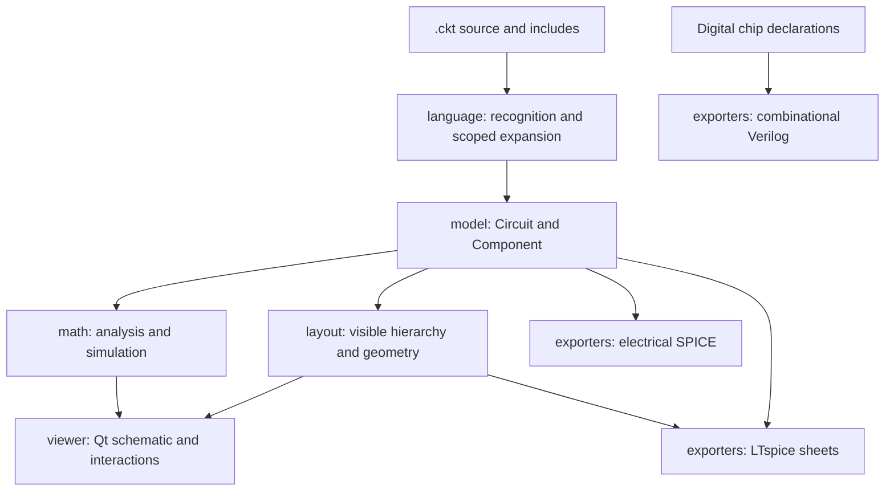

# OOC architecture

OOC is a circuit language with an interactive viewer. VS Code owns source editing in the normal IDE workflow. The viewer owns schematic geometry, probes, results, simulation controls and export dialogs. The optional original editor remains available without the `--editor` launcher flag.

The refactor preserves the language and electrical models. It changes where code lives and which object owns a document; it does not turn analog transistor circuits into FPGA logic or make approximate chip models manufacturer-accurate.

## Find the implementation

```text
circuitlab/
    language/       source syntax, scoped expansion, file linking, graph construction
    model/          electrical graph, devices, probes, hierarchy, errors
    math/           quantities, formulas, linear/nonlinear analysis, numerical results
    layout/         geometry, placement, routing, movement, topology checks, persistence
    exporters/      SPICE netlists, LTspice sheets, combinational Verilog
    tooling/        document session, CLI, source inspection, IDE bridge and hover worker
    viewer/         lightweight window, Qt schematic/results/scope, optional old editor
    libraries/      packaged chip definitions and shared .ckt helper circuits
    __init__.py     package marker
    __main__.py     application launcher; python -m circuitlab
ide/
    vscode/         extension runtime, structure scanner, hover client and local updates
    visual-studio/  grammar installer and external-tool setup for the full Windows IDE
tests/
    fixtures/       owned test inputs; editable examples are not golden test data
examples/           circuits for users to inspect and modify
```

Import directly from the module that owns the implementation: for example, `circuitlab.language.compiler`, `circuitlab.math.analysis`, or `circuitlab.viewer.schematic`. The package root contains only its marker and launcher. There are no old-name forwarding files or dynamic alias registry. The command-line compiler is `python -m circuitlab.tooling.cli`; the hover worker is `python -m circuitlab.tooling.hover`.

## Source to circuit



This diagram shows software flow, not an electrical schematic. The digital compiler is an independent path.

The public electrical entry point is [`language.compiler.compile_circuit`](../circuitlab/language/compiler.py). It accepts source text, analysis mode, optional source path, and an optional reader for linked source. The language helpers retain legacy and modern forms, build scoped source rows, expand definitions and compile-time control flow, and construct an electrical graph.

- [`language/document.py`](../circuitlab/language/document.py) elaborates one source document into a `CircuitProgram` with scoped rows, connector declarations and hierarchy instances.
- [`language/builder.py`](../circuitlab/language/builder.py) consumes that program and constructs components, groups, source state and final electrical connections. The compiler entry point delegates to these modules.
- [`language/syntax.py`](../circuitlab/language/syntax.py) recognizes source forms and retains source locations.
- [`language/methods.py`](../circuitlab/language/methods.py) binds parameters and creates independent component/net names for each call.
- [`language/control_flow.py`](../circuitlab/language/control_flow.py) evaluates bounded integer/Boolean loops and conditions at compilation time.
- [`language/linked.py`](../circuitlab/language/linked.py) resolves includes, library definitions and explicit file connectors.
- [`language/gates.py`](../circuitlab/language/gates.py) builds the transistor networks for built-in gate calls.

The compiler uses shared recognizers and scoped source rows; it is not a general Python interpreter or a conventional full OOP runtime. Existing dispatch and scoping semantics must remain stable during implementation cleanup.

## One electrical authority

[`model/graph.py`](../circuitlab/model/graph.py) defines `Circuit`, `Component`, `Probe`, `Pulse`, `MethodInstance` and `CircuitError`. The graph records electrical terminals, values, grounds, source origins and hierarchy ownership.

The same graph supports solving, drawing and export. A separate `Layout` holds positions and wire segments. Moving a symbol may reroute a visual wire; it must not change the component's value or which electrical net reaches each terminal. Crossings without junctions must remain separate nets. [`layout/checks.py`](../circuitlab/layout/checks.py) verifies these invariants.

Terminal membership and conducting connectivity are related but different. An ideal op amp senses its two input voltages; its output branch conducts. Do not replace every solver connection rule with a traversal through all displayed pins.

The geometry implementation is split by purpose: [`layout/geometry.py`](../circuitlab/layout/geometry.py) contains drawing data and terminal primitives; [`layout/automatic.py`](../circuitlab/layout/automatic.py) handles recognized circuit shapes; [`layout/routing.py`](../circuitlab/layout/routing.py) routes arbitrary graphs; and [`layout/editing.py`](../circuitlab/layout/editing.py) moves, rotates, slides and splits existing geometry. Shared crossing/topology checks belong in `layout/checks.py`. Import geometry, routing and editing functions from those modules directly.

## Document and UI ownership

[`tooling/session.py`](../circuitlab/tooling/session.py) contains `CircuitSession`, which has no Qt dependency. It owns the accepted source/path/revision, compile diagnostics, numerical solution, render graph and optional probe-name overrides. Loading a file is transactional: unreadable or undecodable input does not replace the current document. Replacing source invalidates prior results.

Analysis and rendering stay separate. Historical group calculations can use a reduced form while the schematic needs expanded components. A circuit can therefore render even when its operating point is unavailable. A scalar quantity calculation can succeed without having a schematic.

[`viewer/window.py`](../circuitlab/viewer/window.py) is the IDE viewer. It constructs the schematic, results, scope and diagnostic controls directly, without a `CircuitEditor`, hidden text document or source tabs. Its **Save layout** operation writes only the layout sidecar.

[`viewer/legacy.py`](../circuitlab/viewer/legacy.py) retains the original editor workflows. Shared panels/dialogs live in [`viewer/widgets.py`](../circuitlab/viewer/widgets.py), and safe export file operations in [`viewer/exports.py`](../circuitlab/viewer/exports.py). The launcher imports the selected shell lazily; starting the IDE viewer does not load the legacy editor.

| Data | Owner / persistence |
| --- | --- |
| Components, values and terminal connections | `.ckt` source and compiled `Circuit` |
| Loaded source and accepted results | `CircuitSession` for the IDE viewer |
| Source editor text/tabs | VS Code, or the optional legacy editor |
| Drawing coordinates and wire routes | `Layout`, managed by `SchematicView` |
| Saved circuit-specific geometry | `<circuit>.ckt.layout.json` |
| Shared gate appearance | Existing QSettings gate template store |
| Named probes from older files | `# @pin` source comments |
| IDE-viewer probe edits | Optional sidecar `pin_overrides` |
| Active waveform integration/buffer | Scope/simulation objects |
| Viewer process connection | VS Code runtime for its current extension session |

## Preserve saved layouts

[`layout/persistence.py`](../circuitlab/layout/persistence.py) still reads and writes version-1 sidecars. Restoration binds saved coordinates to actual component names/kinds/terminal nets and checks topology. An incompatible layout is not allowed to connect the wrong circuit.

Shared gate templates retain the settings namespace `Electric Circuits` / `Object-Oriented Circuits` and keys `gate-layouts/v1/<gate>/<inputs>`, with their separate automatic flags. Circuit-specific placements retain precedence over shared/default gate geometry. Changing a default must not erase the user's saved NOT, AND, NAND, OR or NOR layout.

Viewer probe changes are optional v1 sidecar fields. A string overrides a source-comment caption; `null` hides a source-defined probe. Missing entries continue to use source comments. Source bytes are not rewritten by the viewer, and the optional editor preserves these overrides when it saves the sidecar.

Hierarchy export resolves stored child placements as well as current manual layouts, so a collapsed package can retain its customized internal arrangement in LTspice. The original topology validation still applies when a saved record is restored.

## Numerical analysis and model limits

[`math/analysis.py`](../circuitlab/math/analysis.py) selects analysis paths and probes. [`math/equations.py`](../circuitlab/math/equations.py) propagates scalar equations and first-order response relations; [`math/linear.py`](../circuitlab/math/linear.py) implements dense nodal analysis; [`math/nonlinear.py`](../circuitlab/math/nonlinear.py) contains generic BJT/switch operating-point and time-domain calculations.

[`math/results.py`](../circuitlab/math/results.py) defines the shared `Network` result record and `SimulationBackend` protocol independently of solver dispatch. Linear and nonlinear implementations share this contract without importing each other's dispatch entry points.

The language's scalar **Transient** choice is not the same mechanism as stepping an electrical circuit in the scope. Preserve their distinct inputs and limitations. The scope retains its worker batches; ordinary compile/solve and rendering still have synchronous paths. This organization alone does not establish a large-circuit responsiveness guarantee or introduce a sparse solver.

The library contains 40 canonical packaged chips, with 33 approximate electrical models and seven pinout-only definitions. Twelve alias files and seven shared helpers are not additional packaged devices. Native generic BJT models do not evaluate arbitrary named SPICE transistor models. Nonlinear AC/port analysis remains unsupported by the built-in solver. See the [chip catalog](../circuitlab/libraries/chips/README.md) and per-device comments for the actual modeled behavior.

## Export and IDE boundaries

Electrical exporters consume the resolved graph. SPICE has its own naming and pin conventions: OOC BJT arguments are base/collector/emitter, while SPICE element order is collector/base/emitter. LTspice export additionally consumes geometry and writes all required hierarchy companions. Export does not run an external simulator or import arbitrary SPICE models into the native solver.

[`exporters/verilog.py`](../circuitlab/exporters/verilog.py) supports standalone single-bit combinational chips. `!` is inversion in OOC. Analog `chip`/`gate` implementations, BJTs, compile-time electrical loops and sequential charge-storage models are not translated into synthesizable FPGA hardware.

[`tooling/source_info.py`](../circuitlab/tooling/source_info.py) provides non-widget text inspection for editor help and hover lookups. The offscreen hover process uses Qt to draw reference diagrams, but does not create the original source editor. A highlighted wire path is representative connectivity, not simulated current flow.

VS Code uses private process pipes for viewer reloads and hover requests. It combines save events and reuses the current viewer process; dirty layout blocks background refresh until saved. Compatible packaged JavaScript runtime updates apply live, while registration/grammar/bootstrap changes can require reload. Running Python processes still need restart after implementation changes. The full Windows Visual Studio integration remains grammar plus external tools, not the VS Code extension.

## Regression contracts

The refactor suite preserves source scopes, terminal mappings, numeric values, selected SPICE text and saved root/child geometry using [immutable fixtures](../tests/fixtures/refactor/README.md). Separate nominal gate tests exercise 62 truth-table cases. Existing wiring, Qt, source, exporter and captured MATLAB parity suites remain in place.

Expected output is a behavior contract, not permission to copy an old bug into a new model forever. Deliberate language/model changes require a focused explanation and independently justified expected results. See [development.md](development.md) for recipes and checks.
